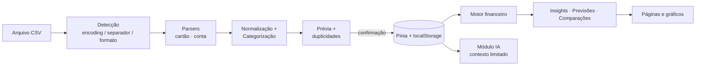

<div align="center">

# 💚 Clareza Financeira

**Transforme seus extratos em decisões financeiras inteligentes — sem sair do seu navegador.**

[](LICENSE)


</div>

---

## 📖 Sobre o projeto

O **Clareza Financeira** é um aplicativo web open source de inteligência financeira pessoal. Você importa extratos de conta corrente e faturas de cartão de crédito em **CSV**, e o app consolida as movimentações, categoriza os gastos e gera análises **auditáveis**: tendências, recorrências, oportunidades de economia, comparações entre períodos e previsões.

Tudo roda **localmente**. Não há login, cadastro, servidor, banco de dados remoto nem chave de API. Seus extratos nunca saem do seu dispositivo.

### Objetivo

Ajudar qualquer pessoa a entender a própria vida financeira **sem precisar de conhecimentos de contabilidade**, com números confiáveis e explicáveis:

- cada indicador mostra **o que representa e como foi calculado**;
- valores estimados aparecem **marcados como estimados**;
- quando faltam dados, o app **diz isso** em vez de inventar resultados.

---

## ✨ Funcionalidades

### Importação robusta
- Importação de **vários arquivos** de uma vez, por clique ou arrastar e soltar.
- Detecção automática do **formato** (fatura de cartão ou extrato bancário), do **encoding** (UTF-8, UTF-8 com BOM, Windows-1252) e do **separador** (`;`, `,` ou tabulação), com ajuste manual se necessário.
- **Prévia antes de salvar**: registros válidos e inválidos, créditos, débitos, período e uma amostra das transações.
- **Erros informados por número de linha**; nenhuma linha é descartada em silêncio.
- Detecção de **arquivo já importado**, **períodos sobrepostos** e **transações repetidas**.
- Verificação de **consistência dos saldos** do extrato: inconsistências são apontadas, nunca "corrigidas".

### Análises e inteligência
- Painel com receitas, despesas, resultado, taxa de poupança, consumo no cartão, saídas bancárias, saldo conhecido, recorrências, parcelas futuras e tarifas.
- Alternância entre as visões **Consumo** e **Caixa**.
- **Insights determinísticos**, cada um com evidências, explicação do cálculo, nível de confiança e acesso às transações que o fundamentam.
- Detecção de **cobranças recorrentes**, incluindo reajustes de preço e serviços possivelmente interrompidos.
- **Anomalias** sinalizadas para conferência (gastos fora do padrão, possíveis cobranças duplicadas, estabelecimentos novos), sem nunca afirmar fraude.
- **Previsão** de despesas do mês e projeção dos próximos meses com **faixa de incerteza**.
- **Compromissos futuros** a partir de parcelas explicitamente identificadas (ex.: `03/10`).
- **Comparação de períodos** (A × B) por conta, cartão e categoria, com média diária quando as durações diferem.
- **Orçamentos** com projeção de estouro e limite diário orientativo, e **metas** com cálculo de contribuição mensal e simulação de aporte extra.

### Gestão e exportação
- Edição de transações: categoria, estabelecimento, marcar como transferência, reembolso ou pagamento de fatura, ou ignorar nos indicadores.
- **Regras de categorização** editáveis e com prioridade; correções manuais sempre prevalecem.
- **Filtros combináveis** (período, conta, arquivo, categoria, valor, texto, recorrência, parcelamento…) exibidos como etiquetas removíveis e salvos como favoritos.
- Exportação em **PDF** (A4, com seções selecionáveis), **CSV**, **JSON** e **PNG** dos gráficos.
- **Compartilhamento** de resumos via Web Share API, WhatsApp ou área de transferência, com confirmação prévia e sem dados sensíveis.
- **Backup e restauração** completos em JSON, com opção de mesclar ou substituir.
- **Modo demonstração** com dados sintéticos, isolados dos seus dados reais.
- Tema **claro/escuro**, layout **mobile first** com navegação inferior no celular e barra lateral no desktop.

---

## 🛠️ Tecnologias

| Camada | Tecnologia |
|---|---|
| Interface | [Vue 3](https://vuejs.org/) (Composition API) + TypeScript |
| Build | [Vite](https://vite.dev/) |
| Estado | [Pinia](https://pinia.vuejs.org/) |
| Rotas | [Vue Router](https://router.vuejs.org/) |
| Estilos | [Tailwind CSS](https://tailwindcss.com/) v4 |
| Ícones | [Lucide](https://lucide.dev/) |
| Gráficos | [Apache ECharts](https://echarts.apache.org/) + vue-echarts |
| Leitura de CSV | [Papa Parse](https://www.papaparse.com/) |
| Validação | [Zod](https://zod.dev/) |
| Datas | [date-fns](https://date-fns.org/) |
| PDF | [jsPDF](https://github.com/parallax/jsPDF) + jspdf-autotable |
| Utilitários | [VueUse](https://vueuse.org/) |
| Testes | [Vitest](https://vitest.dev/) + Vue Test Utils + jsdom |
| Persistência | `localStorage` do navegador |

Todas as dependências são gratuitas e com licenças compatíveis com o MIT. Nenhuma é carregada de CDN em tempo de execução.

---

## 📸 Capturas de tela

> Ainda não há capturas de tela publicadas. Para ver o app rapidamente, rode `npm run dev` e clique em **Explorar demonstração**. Contribuições com screenshots (usando apenas os dados de demonstração) são bem-vindas!

---

## 🚀 Começando

### Requisitos
- [Node.js](https://nodejs.org/) **20 ou superior** (testado com Node 24)
- npm 10+
- Um navegador moderno (Chrome, Edge, Firefox, Safari — desktop ou mobile)

### Instalação
```bash
git clone https://github.com/<seu-usuario>/clareza-financeira.git
cd clareza-financeira
npm install
```

### Executar em desenvolvimento
```bash
npm run dev
```
Abra o endereço exibido no terminal (normalmente `http://localhost:5173`).

### Gerar build de produção
```bash
npm run build     # checagem de tipos (vue-tsc) + build em dist/
npm run preview   # serve o build localmente
```
O conteúdo de `dist/` é estático e pode ser hospedado em qualquer serviço de arquivos estáticos (GitHub Pages, Netlify, Cloudflare Pages…). As rotas usam *hash history*, então nenhuma configuração extra de servidor é necessária.

### Executar os testes
```bash
npm test             # executa todos os testes uma vez
npm run test:watch   # modo observação
npm run typecheck    # apenas checagem de tipos
```

---

## 📄 Formatos CSV suportados

### 1. Fatura de cartão de crédito
```csv
Data;Lançamento;Categoria;Tipo;Valor
31/03/2026;AMAZONMKTPLC*GRUPOMULT;OUTROS;Compra à vista;R$ 864,90
12/03/2026;LOJA EXEMPLO PARC 02/10;VESTUARIO;Parcela;R$ 99,99
20/03/2026;ESTORNO AMAZON;OUTROS;Estorno;-R$ 50,00
```
- Datas `DD/MM/AAAA`; valores em reais com vírgula decimal, com ou sem `R$`.
- Na fatura, **valores positivos são compras** e viram saídas de dinheiro; valores negativos são estornos, créditos ou pagamentos. Um valor positivo **não** é tratado como receita.
- A descrição original é preservada e uma versão normalizada é gerada (ex.: `AMAZONMKTPLC*GRUPOMULT` → `Amazon Marketplace`).
- Colunas extras são aceitas, e pequenas variações de cabeçalho são reconhecidas.

### 2. Extrato de conta corrente (com metadados)
```csv
Extrato Conta Corrente
Conta;XXXXXXXXX
Período;01/03/2026 a 31/03/2026
Saldo:;2,05

Data Lançamento;Descrição;Valor;Saldo
05/03/2026;"Pix enviado: Cp :10573521-PIX Marketplace";-127,73;-117,81
```
- As linhas de metadados (conta, período, saldo) são lidas e o cabeçalho real da tabela é localizado automaticamente.
- O "Saldo" do cabeçalho é guardado como **saldo informado**; ele não é assumido como saldo final.
- O app identifica Pix enviado e recebido, transferências, pagamento de fatura, tarifas, juros, saques, depósitos, salário e aplicações e resgates.

### Exemplo de importação
1. Acesse **Mais → Importar extratos**.
2. Arraste um ou mais arquivos CSV.
3. Para cada arquivo, confirme o nome, a conta ou o cartão (ou crie um novo) e, se necessário, o encoding e o separador.
4. Revise a prévia: linhas válidas, erros por linha, duplicidades e avisos de saldo.
5. Clique em **Importar** e confirme. **Nada é salvo antes desta etapa.**

> 🔒 Nunca adicione extratos reais ao repositório. Os testes usam apenas fixtures sintéticas (`src/test/fixtures.ts`).

---

## 🏷️ Como funciona a categorização

A ordem de prioridade é:

1. **Edição manual do usuário**, que nunca é sobrescrita automaticamente.
2. **Regras de categorização**: a regra ativa de maior prioridade que casar com a descrição vence. Os tipos de correspondência são *contém*, *começa com*, *exato* e *regex*.
3. **Categoria informada no CSV** do cartão, mapeada para as categorias do app.
4. **Não classificado**.

Ao corrigir uma transação, você pode **aplicar a mudança a transações semelhantes** (mesmo estabelecimento, sem alterar as editadas manualmente) e/ou **criar uma regra automática**. Em **Regras → Reaplicar regras**, as transações não editadas são recategorizadas.

São 38 categorias padrão (Moradia, Supermercado, Delivery, Assinaturas, Tarifas, Salário…). Você também pode criar categorias próprias e definir se cada uma é **essencial**, **não essencial** ou **neutra**. Ao excluir uma categoria, as transações vão para *Não classificado*, preservando o histórico.

A classificação **não usa IA externa**: é feita por regras locais e determinísticas.

---

## 📊 Como funcionam as análises

Os cálculos ficam em módulos TypeScript **puros e testados** (`src/modules`), independentes da interface. Todos os valores monetários são **centavos inteiros**: strings brasileiras nunca passam por `parseFloat`, o que evita erros de ponto flutuante.

### Duas perspectivas
- **Consumo** — *quando a despesa aconteceu*. Soma as compras no cartão e os débitos de consumo da conta.
- **Caixa** — *quando o dinheiro saiu da conta*. Considera apenas a conta corrente, incluindo o pagamento da fatura.

As duas somas **nunca são misturadas** numa mesma métrica.

### Regras para evitar dupla contagem

| Movimentação | Consumo | Caixa |
|---|---|---|
| Compra no cartão | ✅ despesa | — |
| Pagamento de fatura | ❌ excluído | ✅ saída |
| Transferência entre contas próprias | ❌ excluída | ❌ excluída |
| Aplicação / resgate de investimento | ❌ excluído | conforme marcação |
| Estorno / reembolso | reduz a despesa | entrada |
| Transação marcada como "ignorada" | ❌ excluída | ❌ excluída |

Se a classificação automática errar, você pode marcar manualmente uma transação como transferência, pagamento de fatura ou reembolso.

### Principais indicadores

| Indicador | Como é calculado |
|---|---|
| Receitas | Créditos da conta corrente, exceto transferências, estornos e resgates |
| Despesas | Conforme a visão escolhida; estornos reduzem o total |
| Resultado | Receitas − Despesas |
| Taxa de poupança | Resultado ÷ Receitas (indisponível sem receitas) |
| Consumo no cartão | Compras − estornos nos cartões |
| Saldo conhecido | Último saldo **presente no extrato**, nunca estimado |
| Recorrentes / mês | Cobranças com intervalo regular (~7, ~30 ou ~365 dias) e valores semelhantes (±15%) |
| Parcelas futuras | Apenas parcelas explícitas no CSV (ex.: `02/10`) |
| Previsão do mês | Ritmo diário observado combinado com a média dos meses anteriores, com faixa e nível de confiança |

**Princípios de confiabilidade:**
- meses sem arquivo importado **não** são tratados como gasto zero;
- limites de cartão, datas de vencimento, rendimentos ou saldos devedores **não são inventados**;
- sem dados suficientes, o insight ou a previsão simplesmente **não é gerado**.

Detalhes completos estão em [`docs/regras-financeiras.md`](docs/regras-financeiras.md).

---

## 🔎 Filtros e comparações

### Filtros
Use os atalhos de período (Mês, 30/90 dias, Trimestre, Semestre, Ano…) ou abra **Filtros** para combinar:
- datas, contas, cartões e arquivos importados;
- categorias e texto da descrição;
- valor mínimo e máximo, entradas ou saídas;
- essenciais ou não essenciais, recorrentes, parceladas;
- pendentes de classificação, possíveis duplicidades e transações ignoradas.

Os filtros ativos aparecem como etiquetas removíveis, podem ser salvos como **favoritos** e valem para o painel, as transações, os insights e os relatórios. Só datas e identificadores vão para a URL; valores e descrições nunca.

### Comparar períodos
Em **Comparar**, defina os períodos A e B (e, opcionalmente, conta e categoria). O app mostra:
- valores, diferença absoluta e diferença percentual;
- **média diária**, com aviso quando os períodos têm durações diferentes;
- categorias que cresceram ou diminuíram e os estabelecimentos com maior variação;
- um gráfico comparativo e um resumo em texto explicando as diferenças.

---

## 📤 Relatórios, compartilhamento e backup

### Relatórios PDF
Em **Mais → Relatórios**, escolha o modelo e as seções (indicadores, evolução mensal, categorias, estabelecimentos, insights, transações) e clique em **Exportar PDF**. O PDF é gerado localmente, em A4, com paginação, rodapé, explicação das métricas e avisos sobre dados incompletos.

### Compartilhamento
O botão **Compartilhar** pede confirmação e envia um resumo **sem números de conta nem descrições originais**. O app tenta, nesta ordem:
1. a Web Share API do dispositivo, com o PDF quando o navegador suporta arquivos;
2. o link oficial do WhatsApp (apenas texto);
3. a cópia para a área de transferência.

### Backup e restauração
Em **Mais → Configurações e backup**:
- **Baixar backup** gera um JSON com todos os dados;
- **Restaurar** valida o arquivo antes e permite **mesclar** (os dados atuais prevalecem em conflitos) ou **substituir tudo**;
- **Apagar todos os dados** exige confirmação.

Também é possível exportar as transações filtradas em CSV ou JSON e cada gráfico em PNG.

---

## 💾 Limitações do armazenamento local

Os dados ficam no `localStorage` do navegador, o que traz algumas limitações importantes:

- **Capacidade limitada**, em geral cerca de 5 MB por site. O uso aparece em *Configurações*. Se o espaço acabar, o app **avisa e não finge que salvou**; faça um backup e remova importações antigas.
- **Sem criptografia.** Qualquer pessoa com acesso ao seu perfil do navegador pode ver os dados.
- **Limpar os dados do navegador apaga tudo.** Navegação anônima também não mantém os dados.
- **Os dados não sincronizam entre dispositivos.** Use o backup em JSON para transferi-los.

👉 **Faça backups regularmente.**

---

## 🏗️ Arquitetura



Princípios:
- **Lógica separada da apresentação:** os cálculos são funções puras em `src/modules`, sem dependência de Vue.
- **Mutações puras e gravação segura:** `stores/mutations.ts` transforma os dados, e a store só atualiza o estado **depois** de gravar no armazenamento com sucesso.
- **Carregamento sob demanda:** as rotas, o gerador de PDF e o módulo de IA são carregados apenas quando usados.
- **Persistência versionada:** os dados guardam a versão do formato, as migrações são automáticas e os dados são validados com Zod.

Mais detalhes em [`docs/arquitetura.md`](docs/arquitetura.md) e [`docs/modelo-de-dados.md`](docs/modelo-de-dados.md).

### Estrutura de pastas
```text
src/
├── components/        # componentes reutilizáveis (cards, gráficos, filtros, diálogos)
│   └── charts/        # configurações dos gráficos ECharts
├── composables/       # useAnalytics, useImportWizard
├── constants/         # categorias, regras padrão, navegação
├── layouts/           # layout responsivo (sidebar + navegação inferior)
├── modules/
│   ├── ai/            # contratos de provider e construção de contexto
│   ├── analytics/     # motor de métricas (consumo × caixa)
│   ├── categories/    # motor de regras
│   ├── comparison/    # comparação entre períodos
│   ├── forecast/      # previsões e parcelas futuras
│   ├── import/        # decodificação, parsers, duplicidade, demonstração
│   ├── insights/      # recorrências, anomalias, insights
│   └── transactions/  # filtros
├── pages/             # telas (lazy loading)
├── router/            # rotas
├── services/
│   ├── export/        # PDF, CSV, compartilhamento
│   └── storage/       # localStorage, migrações, backup
├── stores/            # Pinia + mutações puras
├── styles/            # Tailwind e design system
├── test/              # fixtures sintéticas
├── types/             # modelos TypeScript
└── utils/             # dinheiro (centavos), datas, texto
docs/                  # documentação técnica
```

---

## 🤖 Módulo de IA local (futuro)

O módulo `src/modules/ai` já define a arquitetura para integrar uma IA que rode **inteiramente no navegador** (ex.: WebLLM ou Transformers.js), **sem incluir modelos no pacote principal**.

- **`AIProvider`** é a interface com `initialize`, `isAvailable`, `analyze`, `ask`, `cancel` e `dispose`.
- **`registerProvider(id, () => import(...))`** registra provedores com carregamento sob demanda.
- **`buildContext()`** monta um contexto **resumido e limitado** (totais, categorias, tendências, recorrências, qualidade dos dados), sem expor todo o histórico.
- **Provider padrão desativado:** o app nunca finge que uma IA está respondendo.

Hoje, a página **Consultor IA** responde perguntas comuns com **regras determinísticas** e identifica cada resposta como "resposta por regras".

> As descrições importadas dos extratos são tratadas como **dados não confiáveis** e nunca como instruções ao assistente.

---

## 🔐 Privacidade

- **Nenhum dado financeiro sai do seu dispositivo.** Não há servidor, API ou telemetria.
- Não há scripts de terceiros nem CDNs em tempo de execução.
- Nenhuma senha ou credencial bancária é solicitada ou armazenada.
- O CSV é tratado como fonte não confiável: o conteúdo é validado e exibido com escape, e a exportação CSV neutraliza fórmulas de planilha.
- Exclusões destrutivas exigem confirmação.
- Resumos compartilháveis omitem contas e descrições originais por padrão.

O app **não** afirma que o `localStorage` é seguro ou criptografado. Veja a seção [Limitações do armazenamento local](#-limitações-do-armazenamento-local).

---

## 🤝 Como contribuir

Contribuições são muito bem-vindas! Leia o [`CONTRIBUTING.md`](CONTRIBUTING.md) e siga o fluxo:

1. Faça um *fork* e crie uma branch: `git checkout -b feat/minha-melhoria`.
2. Implemente a mudança. A lógica financeira vai em `src/modules`, como funções puras **com testes**.
3. Garanta que tudo passa:
   ```bash
   npm test
   npm run build
   ```
4. Abra um *Pull Request* descrevendo o problema e a solução.

Regras essenciais:
- Use sempre **centavos inteiros**; nunca `parseFloat` em valores em reais.
- **Nunca** versione extratos reais; use apenas dados sintéticos.
- Não adicione dependências que enviem dados para fora do navegador.
- Mantenha a interface em **português brasileiro**.

Ideias para começar: suporte a novos formatos de banco, novos gráficos, melhorias de acessibilidade, testes de componentes e capturas de tela.

---

## 🗺️ Roadmap

**Concluído (v0.1)**
- [x] Importação dos dois formatos, com prévia, duplicidade e verificação de saldos
- [x] Persistência local versionada, backup e restauração
- [x] Visões de consumo e caixa, sem dupla contagem de fatura
- [x] Painel, filtros, comparação de períodos
- [x] Insights, recorrências, anomalias, previsões e parcelas futuras
- [x] Orçamentos, metas, relatórios PDF e compartilhamento
- [x] Arquitetura do módulo de IA e consultor por regras

**Próximos passos**
- [ ] Testes E2E com Playwright e testes de componentes
- [ ] PWA com funcionamento offline completo
- [ ] Web Worker para arquivos muito grandes
- [ ] Gráficos de heatmap, calendário, treemap e waterfall
- [ ] Score de saúde financeira explicável e diagnóstico consolidado
- [ ] Simulações de cenários (conservador, moderado, otimista)
- [ ] Análise de custos bancários por instituição
- [ ] Provider opcional de IA local (WebLLM / Transformers.js)
- [ ] Suporte a mais formatos (OFX e layouts de outros bancos)
- [ ] Redução do tamanho do pacote de gráficos

---

## 📜 Licença

Distribuído sob a licença **MIT**. Veja [`LICENSE`](LICENSE) para mais informações.

As dependências mantêm suas próprias licenças, todas compatíveis com uso open source.

---

<div align="center">

Feito com 💚 para quem quer **clareza** sobre o próprio dinheiro.

<sub>O Clareza Financeira é uma ferramenta de apoio e não substitui orientação financeira profissional.</sub>

</div>
