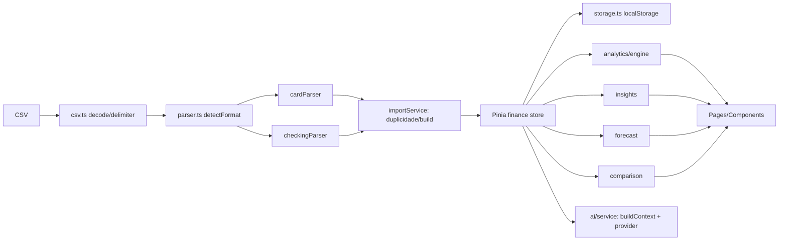

# Arquitetura

- Módulos em `src/modules` são funções puras, sem Vue, cobertas por testes.
- `stores/mutations.ts` contém todas as mutações puras; a store só persiste e só atualiza o estado se a gravação tiver sucesso.
- Rotas com lazy loading; jsPDF e o módulo de IA são importados sob demanda.
- IA: implemente `AIProvider` e registre com `registerProvider(id, () => import(...))`. O contexto enviado é resumido e limitado; descrições são dados não confiáveis.
